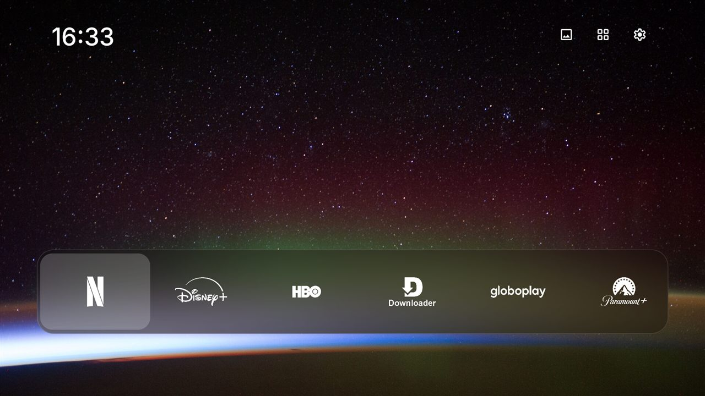
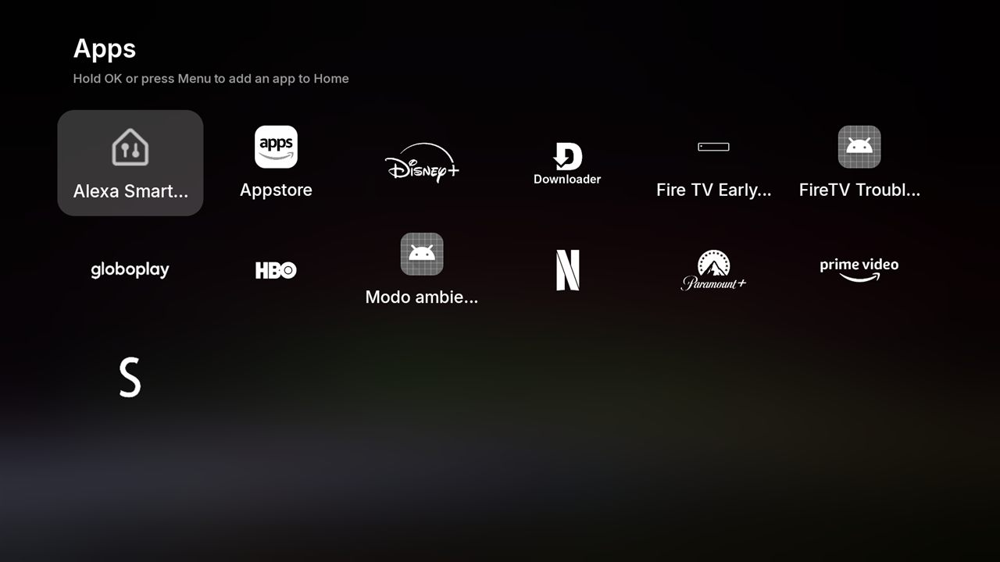

# Firestick Makeover

[Português](README.md)

**Make your Fire TV clean, good-looking and faster.** A home screen with only your apps, shown as
white logos with no background; no Amazon ads or tracking; the remote's app buttons opening what you
choose; and speed tweaks. All from Windows with a double-click, no root, and everything can be undone.

**[⬇ Download the latest version](https://github.com/vitoradriao/firestick-makeover/releases/latest/download/firestick-makeover-windows.zip)**

| The Makeover home screen | All apps |
|---|---|
|  |  |

> [!WARNING]
> Unofficial tool, not affiliated with Amazon. It changes device settings and you use it at your own
> risk. No app is deleted, only disabled, and **Undo everything** brings it all back. If something goes
> badly wrong, a factory reset is the last resort.

## What it does

- **Makeover home screen:** a NASA photo, the time and a glass dock with your apps. Every app shows a
  white logo with no background: Netflix, HBO, YouTube and others have their own, and for the rest
  Makeover cuts the logo out of the app's TV banner and drops its coloured background. The remote's
  **Home** button opens Makeover. Amazon's screen may flash for a moment first, which is normal on
  Fire TV.
- **Remote buttons:** the remote's app buttons (Prime Video, Peacock, Disney+...) can open the app you
  choose. Handy for a service you don't pay for, or one that doesn't exist in your country.
- **Cleanup:** turns off Amazon ads, tracking, telemetry and the Amazon apps you don't use. You pick
  what goes, in groups (Alexa, Prime Video, updates...).
- **Optimizations:** 2x faster animations, an ad-blocking DNS (AdGuard) and full compilation of apps,
  all optional.
- **Undo and re-apply:** after a Fire OS update, one option turns back off what came back; another
  undoes everything.

## Tested on

| | |
|---|---|
| Device | **Fire TV Stick 4K (2nd gen)**, model `AFTKRT` |
| System | **Fire OS 8.1.8.5** (`RS8185/3898`), Android 11 |
| Remote | Alexa Voice Remote with Netflix, Prime Video, Disney+ and Peacock buttons |
| PC | Windows 11, with Windows PowerShell 5.1 (built into Windows) and PowerShell 7 |

| Fire OS | What to expect |
|---|---|
| 8 (Fire TV Stick 4K 2nd gen, 4K Max 2nd gen, Cube 3rd gen) | Tested on the 4K 2nd gen. Other Fire OS 8 models should behave the same but **are untested**. |
| 7 (Fire TV Stick 3rd gen, Lite, 4K and 4K Max 1st gen) | **Untested.** Cleanup and optimizations should work. The home screen and buttons rely on accessibility services, which Fire OS 7.6 reportedly blocks in some cases. |
| 6 or older | Untested. Probably only the cleanup works. |
| Vega OS (Fire TV Stick 4K Select and newer models) | **Won't work.** No Android apps and no ADB Debugging. |

To see your version: **Settings → My Fire TV → About**. Tried another device?
[Tell us how it went](https://github.com/vitoradriao/firestick-makeover/issues/new).

## What you need

- A **Windows 10 or 11** PC on the same network as the Fire TV.
- About 20 minutes.
- Nothing else: the tool downloads the one thing it needs (Google's adb) by itself.

## Step by step

### 1. Download and extract

1. Click **[⬇ Download](https://github.com/vitoradriao/firestick-makeover/releases/latest/download/firestick-makeover-windows.zip)**.
   `firestick-makeover-windows.zip` lands in **Downloads**.
2. In File Explorer, right-click the zip, choose **Extract All...**, then **Extract**.
3. A folder opens with **Start-Here.bat**. You'll use it in step 4.

### 2. Turn off ads in the Fire TV's own settings

The tool can't do this for you. On the TV, with the remote:

1. **Settings** (the gear) → **Preferences** → **Featured Content**: turn off video and audio autoplay.
2. Back, then **Preferences → Privacy Settings**: turn off **Device Usage Data**, **Collect App Usage
   Data** and **Interest-based Ads**.

### 3. Allow the PC to connect

1. **Settings → My Fire TV → About.** With the device name highlighted (first line), press the center
   button **7 times** until it says you are now a developer.
2. Go back one screen. **Developer Options** is now there. Open it.
3. Turn on **ADB Debugging** and confirm.

> [!TIP]
> **5 GHz Wi-Fi:** many ISP routers don't let a device on the **5 GHz** network (name ending in
> `_5G`) talk to a PC on cable. If the tool can't find the Fire TV, connect the Fire TV to the
> **2.4 GHz** network (same name without `_5G`) while installing. It can go back to 5 GHz afterwards:
> nothing installed depends on the PC.

### 4. Run the tool

1. In the folder from step 1, double-click **Start-Here.bat**. If Windows says it protected your PC,
   click **More info → Run anyway**.
2. The first time, it offers to download Google's **platform-tools** (8 MB), which talks to the Fire
   TV. Type **s** (yes) and Enter. This means accepting the
   [Android SDK license](https://developer.android.com/studio/terms).
3. It finds the Fire TV on your network by itself. If it can't, it explains what to check and lets
   you type the IP (**Settings → My Fire TV → About → Network**).
4. **Look at the TV:** "Allow USB debugging?" shows up. Tick **Always allow from this computer** and
   choose **OK**.
5. First time? Type **F** for the full guided setup. Or pick an option:

| Option | What it does |
|---|---|
| **F** | Full setup: home screen, buttons, optimizations and cleanup, in that order, asking about each. |
| **1** | Cleanup preview: shows what would be turned off. Changes nothing. |
| **2** | Cleanup: turns off ads and tracking, and asks about each optional group. |
| **3** | Installs or updates the Makeover home screen and picks the wallpaper. |
| **4** | Chooses the app each remote app button opens. |
| **5** | Optimizations: animations, ad-blocking DNS, app compilation. |
| **6** | Re-apply: after a Fire OS update, turns back off what came back and turns the home screen and buttons back on. |
| **7** | Undo everything: turns back on what was turned off, restores the settings and removes Makeover. |
| **8** | Opens the Fire TV settings on the TV. |

The tool's prompts are in Portuguese: **s** means yes, **n** means no, and Enter keeps the default
shown in capitals.

When the cleanup finishes, let the tool restart the Fire TV.

## Using the home screen

- **Home** on the remote opens Makeover, from inside apps and from the all-apps grid too.
- **Hold OK** on a dock app (or press **☰ Menu**) to move it left or right, or remove it.
- Top right: the **picture icon** changes the wallpaper, the **grid** opens every app (hold OK on one
  to add it to the dock), and the **gear** opens Fire TV settings, Amazon's home screen, or a Makeover
  update.
- **Updates:** once a day Makeover checks this repository's releases. When there's a new one it shows
  a notice and **Update to Makeover** under the gear. Fire TV asks you to confirm the install.

## Remote buttons

Option **4** lists your installed apps and asks what each button should open. Known buttons:

| Button | Text Fire OS writes to the log | Tested |
|---|---|---|
| Prime Video | `deeplink_prime_video` | Yes (→ HBO Max) |
| Peacock | `asin=B08BG9MPT9` | Yes (→ SmartTube) |
| Disney+ | `asin=B07Y8SJGCV` | Seen in the log; remap not tested |
| Netflix | no text of its own | Can't be remapped (see below) |

**Another button or remote?** With the Fire TV connected, run in the tool's folder:

```powershell
.\platform-tools\adb.exe logcat -v brief -s ActivityTaskManager:I
```

Press the button and find the `START u0` line with `amzns://apps/android?...`. Copy a piece only that
button has, like `asin=B0XXXXXXXX`. Stop with `Ctrl+C`. In option **4**, answer **s** to "another
button" and paste it.

**Netflix:** the button opens Netflix directly, exactly like opening it from the home screen, so
there's no way to tell them apart. **Disney+ and other apps you have installed:** the original app
still opens behind the chosen one, which uses a bit of memory.

## Optimizations

| Tweak | What changes | Note |
|---|---|---|
| 0.5x animations | Menus and app switching feel snappier | No known side effects. |
| AdGuard DNS | Blocks ad and tracking domains device-wide | Free apps that rely on ads may fail. |
| Compile apps | Fully compiles each installed app; first launch tends to be faster | Takes a few minutes and more storage. Gain not measured. Updating the app undoes it. |

Each setting's previous value is saved on the Fire TV, and **Undo everything** restores it.

## Cleanup

The **basic** group is always applied: ads (Kindle Special Offers), on-screen content recognition,
recommendation rows, autoplay previews, TV shopping, Subscription Central, telemetry, log upload,
uploading your Wi-Fi passwords to Amazon, store demo mode and extras such as Amazon Kids and Luna. The
optional groups are asked one by one:

| Group | What it turns off |
|---|---|
| Alexa | Voice assistant, alerts and voice music. |
| Amazon apps | Amazon Music, Amazon Photos, Silk browser. |
| Casting | Miracast and Amazon's cast receiver. Netflix/YouTube from your phone keep working. |
| Live | The "Live" tab and channel guides. |
| Prime Video | The Prime Video app. |
| Updates | Automatic Fire OS updates. |

The full list, with what each package is, is in [debloat.txt](debloat.txt). Never on the list:
Amazon's home screen (Fire OS won't allow it), Settings, the keyboard, Bluetooth and the remote, the
Appstore (apps check their license through it), sign-in, WebView, DIAL (casting from phone to Netflix
and YouTube), parental controls and the screen saver. Fire OS protects some packages; the tool says
"o Fire OS recusou" (Fire OS refused) and moves on.

What was turned off is recorded on the Fire TV itself (`/sdcard/makeover-disabled.txt`), so
**Re-apply** and **Undo** work even from another computer.

## Troubleshooting

| Problem | Fix |
|---|---|
| The tool can't find the Fire TV | Is the TV on? Is ADB Debugging on ([step 3](#3-allow-the-pc-to-connect))? Same network? Try the Fire TV on **2.4 GHz** (see the tip in step 3). Or type the IP. |
| Nothing happens after connecting | Look at the TV and accept "Allow USB debugging?". |
| "Extraia o zip primeiro" (extract the zip first) | You opened Start-Here.bat from inside the zip. Extract it and run from the new folder. |
| Amazon's screen flashes when pressing Home | Normal: Fire OS always opens Amazon's screen first and Makeover covers it right away. |
| A Fire OS update brought back ads, apps or Amazon's home screen | Option **6** (Re-apply). |
| The remote buttons open the original app again | Option **6** (Re-apply). It happens if someone uses **Force stop** on Makeover in Settings → Applications. |
| I need the Fire TV settings | Gear at the top of Makeover → **Fire TV settings**, option **8**, or hold **Home** and choose **Settings**. |
| Something stopped working | Option **7** (Undo everything) and restart the Fire TV. |

## How it works

Fire TV doesn't let you replace the home screen. Makeover uses an **accessibility service** that
notices when Amazon's screen opens and puts Makeover on top straight away. The remote buttons use a
second service that reads, in the system log, the line Fire OS writes when a button is pressed, and
opens the chosen app. Permission to read the log (`READ_LOGS`) is granted once over adb. Makeover only
reads app-launch lines (`ActivityTaskManager`) and sends nothing anywhere. Its only connection is to
this repository's releases, to look for updates.

The cleanup uses `pm disable-user`, the same "Disable" that exists for regular apps. Nothing is
uninstalled.

## For developers

To build the launcher you need JDK 17 or newer:

```powershell
.\tools\get-sdk.ps1      # downloads the Android SDK parts needed (125 MB) into sdk\
.\tools\build.ps1        # builds dist\makeover.apk, signed with a development key
```

To try it on your Fire TV, run `makeover.ps1` from the repository root: it uses `dist\makeover.apk`.
Releases are signed with a key kept outside the repository (`tools\release.ps1` explains how to point
to it). Without the same key, Fire TV won't install one version over another.

The launcher code is in `launcher/src`. What changed from FireFrame is listed in
[THIRD-PARTY-NOTICES.md](THIRD-PARTY-NOTICES.md).

## Credits and license

[MIT](LICENSE) © Vitor Adrião. The home screen and the cleanup list derive from
[FireFrame](https://github.com/dyascj/FireFrame) by CJ Dyas (MIT). Inter fonts (OFL), Simple Icons
logos (CC0), Material Symbols icons (Apache 2.0) and NASA photos (public domain): details in
[THIRD-PARTY-NOTICES.md](THIRD-PARTY-NOTICES.md). Not affiliated with Amazon or the streaming services
mentioned.
