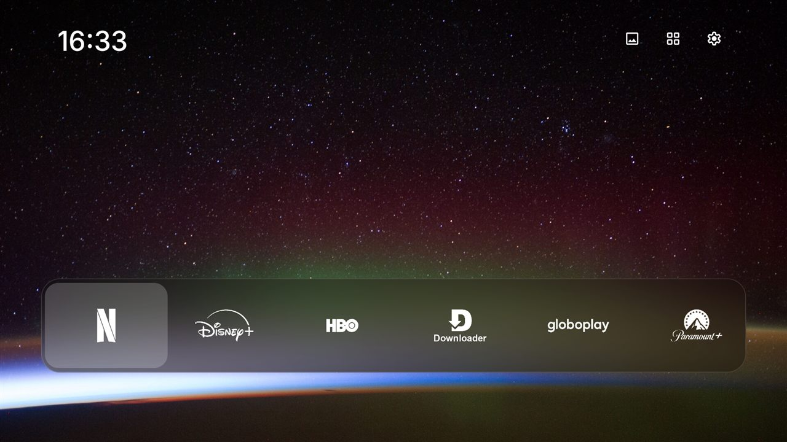
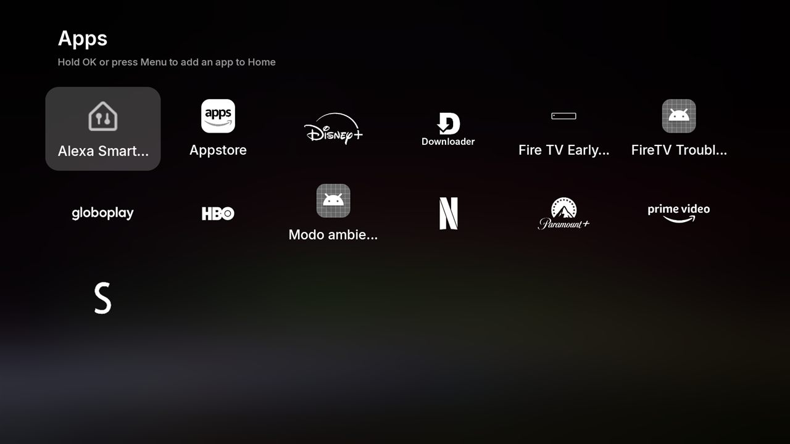

# Firestick Makeover

[English](README.en.md)

**Deixe o seu Fire TV limpo, bonito e mais rápido.** Uma tela inicial só com os seus apps e logos
brancos sem fundo, sem propaganda nem rastreamento da Amazon, os botões de app do controle abrindo o
que você quiser e ajustes de velocidade. Tudo pelo Windows com um clique duplo, sem root, e tudo
pode ser desfeito.

**[⬇ Baixar a versão mais recente](https://github.com/vitoradriao/firestick-makeover/releases/latest/download/firestick-makeover-windows.zip)**

| A tela inicial Makeover | Todos os apps |
|---|---|
|  |  |

> [!WARNING]
> Ferramenta não oficial, sem ligação com a Amazon. Ela muda configurações do aparelho e você usa
> por sua conta e risco. Nenhum app é apagado, só desativado, e **Desfazer tudo** traz tudo de volta.
> Se algo der muito errado, a restauração de fábrica é a última saída.

## O que ele faz

- **Tela inicial Makeover:** uma foto da NASA, o relógio e um dock de vidro com os seus apps. Os
  logos ficam brancos e sem fundo em todos os apps: Netflix, HBO, YouTube e outros têm logo próprio,
  e para os demais o Makeover recorta o logo do banner do app e tira o fundo colorido. O botão
  **Home** do controle passa a abrir o Makeover. A tela da Amazon pode aparecer por um instante
  antes, e isso é normal no Fire TV.
- **Botões do controle:** os botões de app do controle (Prime Video, Peacock, Disney+...) podem abrir
  o app que você escolher. Útil para o botão de um serviço que você não assina ou que nem existe no
  Brasil.
- **Limpeza:** desativa anúncios, rastreamento, telemetria e apps da Amazon que você não usa. Você
  escolhe o que desativar em grupos (Alexa, Prime Video, atualizações...).
- **Otimizações:** animações 2x mais rápidas, DNS que bloqueia anúncios (AdGuard) e compilação
  completa dos apps, todos opcionais.
- **Desfazer e reaplicar:** depois de uma atualização do Fire OS, uma opção religa o que voltou; outra
  desfaz tudo.

## Testado em

| | |
|---|---|
| Aparelho | **Fire TV Stick 4K (2ª geração)**, modelo `AFTKRT` |
| Sistema | **Fire OS 8.1.8.5** (`RS8185/3898`), Android 11 |
| Controle | Alexa Voice Remote com os botões Netflix, Prime Video, Disney+ e Peacock |
| PC | Windows 11, com Windows PowerShell 5.1 (o que já vem no Windows) e PowerShell 7 |

| Fire OS | O que esperar |
|---|---|
| 8 (Fire TV Stick 4K 2ª geração, 4K Max 2ª geração, Cube 3ª geração) | Testado no 4K 2ª geração. Os outros modelos com Fire OS 8 devem funcionar igual, mas **não foram testados**. |
| 7 (Fire TV Stick 3ª geração, Lite, 4K e 4K Max 1ª geração) | **Não testado.** A limpeza e as otimizações devem funcionar. A tela inicial e os botões dependem de serviços de acessibilidade, e há relatos de que o Fire OS 7.6 bloqueia alguns. |
| 6 ou anterior | Não testado. Provavelmente só a limpeza funciona. |
| Vega OS (Fire TV Stick 4K Select e modelos novos) | **Não funciona.** Não roda apps Android nem tem Depuração ADB. |

Para ver a sua versão: **Configurações → Minha Fire TV → Sobre**. Testou em outro aparelho?
[Conte como foi](https://github.com/vitoradriao/firestick-makeover/issues/new).

## O que você precisa

- Um PC com **Windows 10 ou 11** na mesma rede do Fire TV.
- Uns 20 minutos.
- Nada mais: o programa baixa sozinho a única ferramenta de que precisa (o adb do Google).

## Passo a passo

### 1. Baixe e extraia

1. Clique em **[⬇ Baixar](https://github.com/vitoradriao/firestick-makeover/releases/latest/download/firestick-makeover-windows.zip)**.
   O arquivo `firestick-makeover-windows.zip` vai para a pasta **Downloads**.
2. No Explorador de Arquivos, clique com o botão direito no zip, escolha **Extrair tudo...** e depois
   **Extrair**.
3. Abre uma pasta com o **Start-Here.bat**. Você vai usar ele no passo 4.

### 2. Desligue os anúncios nas configurações do Fire TV

Isso o programa não consegue fazer por você. Na TV, com o controle:

1. Vá em **Configurações** (a engrenagem) → **Preferências** → **Conteúdo em destaque** e desligue a
   reprodução automática de vídeo e de áudio.
2. Volte e entre em **Preferências → Configurações de privacidade**. Desligue **Dados de uso do
   dispositivo**, **Coletar dados de uso de apps** e **Anúncios baseados em interesses**.

### 3. Libere a conexão com o PC

1. **Configurações → Minha Fire TV → Sobre.** Com o nome do aparelho selecionado (a primeira linha),
   aperte o botão central **7 vezes**, até aparecer "Você agora é um desenvolvedor".
2. Volte uma tela. Agora existe **Opções do desenvolvedor**. Entre.
3. Ligue **Depuração ADB** e confirme o aviso.

> [!TIP]
> **Wi-Fi 5 GHz:** muitos roteadores de operadora não deixam um aparelho na rede **5 GHz** (nome
> terminando em `_5G`) conversar com um PC ligado no cabo. Se o programa não achar o Fire TV, conecte
> o Fire TV na rede **2.4 GHz** (o mesmo nome sem `_5G`) durante a instalação. Depois ele pode voltar
> para a 5 GHz: nada do que foi instalado depende do PC.

### 4. Rode o programa

1. Na pasta do passo 1, dê dois cliques em **Start-Here.bat**. Se o Windows mostrar "O Windows
   protegeu o computador", clique em **Mais informações → Executar assim mesmo**.
2. Na primeira vez, ele oferece baixar o **platform-tools** do Google (8 MB), que é o que conversa com
   o Fire TV. Digite **s** e Enter. Isso significa aceitar a
   [licença do Android SDK](https://developer.android.com/studio/terms).
3. Ele procura o Fire TV na sua rede sozinho. Se não achar, explica o que conferir e deixa você
   digitar o IP (**Configurações → Minha Fire TV → Sobre → Rede**).
4. **Olhe a TV:** aparece "Permitir depuração USB?". Marque **Sempre permitir deste computador** e
   escolha **OK**.
5. Primeira vez? Digite **F** para a instalação completa, passo a passo. Ou escolha uma opção:

| Opção | O que faz |
|---|---|
| **F** | Instalação completa: tela inicial, botões, otimizações e limpeza, nessa ordem, perguntando cada coisa. |
| **1** | Prévia da limpeza: mostra o que seria desativado. Não muda nada. |
| **2** | Limpeza: desativa anúncios e rastreamento e pergunta sobre cada grupo opcional. |
| **3** | Instala ou atualiza a tela inicial Makeover e escolhe o papel de parede. |
| **4** | Escolhe o app que cada botão de app do controle abre. |
| **5** | Otimizações: animações, DNS anti-anúncio e compilação dos apps. |
| **6** | Reaplicar: depois de uma atualização do Fire OS, desativa de novo o que voltou e religa a tela inicial e os botões. |
| **7** | Desfazer tudo: reativa o que foi desativado, volta os ajustes e remove o Makeover. |
| **8** | Abre as configurações do Fire TV na TV. |

Quando a limpeza terminar, deixe o programa reiniciar o Fire TV.

## Usando a tela inicial

- **Home** no controle abre o Makeover, inclusive de dentro dos apps e da lista de todos os apps.
- **Segure OK** num app do dock (ou aperte o botão **☰ Menu**) para mover para a esquerda ou para a
  direita, ou tirar do dock.
- No topo à direita: o **ícone de imagem** troca o papel de parede, a **grade** abre todos os apps (segure
  OK num app para pôr no dock) e a **engrenagem** abre as configurações do Fire TV, a tela inicial da
  Amazon ou uma atualização do Makeover.
- **Atualizações:** uma vez por dia o Makeover procura uma versão nova nas releases deste
  repositório. Quando tiver, aparece um aviso e a opção **Update to Makeover** na engrenagem. O Fire
  TV pede uma confirmação para instalar.
- A interface do launcher está em inglês por enquanto.

## Botões do controle

Na opção **4**, o programa lista os apps instalados e pergunta qual cada botão deve abrir. Os botões
conhecidos:

| Botão | Texto que o Fire OS escreve no log | Testado |
|---|---|---|
| Prime Video | `deeplink_prime_video` | Sim (→ HBO Max) |
| Peacock | `asin=B08BG9MPT9` | Sim (→ SmartTube) |
| Disney+ | `asin=B07Y8SJGCV` | Visto no log; troca não testada |
| Netflix | nenhum texto próprio | Não dá para trocar (veja abaixo) |

**Outro botão ou outro controle?** Com o Fire TV conectado, rode na pasta do programa:

```powershell
.\platform-tools\adb.exe logcat -v brief -s ActivityTaskManager:I
```

Aperte o botão e procure a linha `START u0` com `amzns://apps/android?...`. Copie um pedaço que só
esse botão tenha, como `asin=B0XXXXXXXX`. Pare com `Ctrl+C`. Na opção **4**, responda **s** em
"outro botão" e cole o texto.

**Netflix:** o botão abre o Netflix direto, igual a abrir pela tela inicial, então não há como
distinguir os dois. **Disney+ e outros apps que você tem instalados:** o app original ainda abre por
trás do escolhido, o que gasta um pouco de memória.

## Otimizações

| Ajuste | O que muda | Observação |
|---|---|---|
| Animações 0.5x | Menus e troca de apps ficam mais ágeis | Sem efeito colateral conhecido. |
| AdGuard DNS | Bloqueia domínios de anúncio e rastreamento no aparelho todo | Apps gratuitos que dependem de anúncio podem falhar. |
| Compilar apps | Compila cada app instalado por completo; a primeira abertura tende a ficar mais rápida | Leva alguns minutos e usa mais espaço. Ganho não medido. Atualizar o app desfaz. |

O valor anterior de cada ajuste fica guardado no Fire TV, e **Desfazer tudo** volta para ele.

## Limpeza

O grupo **básico** é sempre aplicado: anúncios (Kindle Special Offers), reconhecimento do que passa
na tela, linhas de recomendação, prévias automáticas, compras pela TV, Subscription Central,
telemetria, envio de logs e de senhas de Wi-Fi para a Amazon, modo demonstração e extras como Amazon
Kids e Luna. Os grupos opcionais são perguntados um a um:

| Grupo | O que desativa |
|---|---|
| Alexa | Assistente de voz, avisos e música por voz. |
| Apps da Amazon | Amazon Music, Amazon Photos, navegador Silk. |
| Espelhamento | Miracast e "jogar" do celular pela Amazon. Netflix/YouTube do celular continuam funcionando. |
| Ao vivo | Aba "Ao vivo" e guias de canais. |
| Prime Video | O app do Prime Video. |
| Atualizações | Atualizações automáticas do Fire OS. |

A lista completa, com o que é cada pacote, está em [debloat.txt](debloat.txt). Nunca entram na lista:
a tela inicial da Amazon (o Fire OS não deixa), Configurações, o teclado, Bluetooth e o controle, a
Appstore (os apps conferem a licença por ela), login, WebView, DIAL (transmitir do celular para
Netflix e YouTube), controle dos pais e protetor de tela. Alguns pacotes são protegidos pelo Fire OS;
o programa avisa "o Fire OS recusou" e segue em frente.

O que foi desativado fica anotado no próprio Fire TV (`/sdcard/makeover-disabled.txt`), então
**Reaplicar** e **Desfazer** funcionam até de outro computador.

## Solução de problemas

| Problema | O que fazer |
|---|---|
| O programa não acha o Fire TV | A TV está ligada? A Depuração ADB está ligada ([passo 3](#3-libere-a-conexão-com-o-pc))? O PC e o Fire TV estão na mesma rede? Teste o Fire TV na rede **2.4 GHz** (veja a dica do passo 3). Ou digite o IP. |
| Nada acontece depois de conectar | Olhe a TV e aceite "Permitir depuração USB?". |
| "Extraia o zip primeiro" | Você abriu o Start-Here.bat de dentro do zip. Extraia e rode da pasta nova. |
| A tela da Amazon aparece por um instante ao apertar Home | Normal: o Fire OS sempre abre a tela da Amazon primeiro, e o Makeover cobre ela logo em seguida. |
| Depois de uma atualização do Fire OS voltaram os anúncios, apps ou a tela da Amazon | Opção **6** (Reaplicar). |
| Os botões do controle voltaram a abrir o app original | Opção **6** (Reaplicar). Isso acontece se alguém usar **Forçar parada** no Makeover em Configurações → Aplicativos. |
| Preciso das configurações do Fire TV | Engrenagem no topo do Makeover → **Fire TV settings**, ou opção **8**, ou segure **Home** e escolha **Configurações**. |
| Algo parou de funcionar | Opção **7** (Desfazer tudo) e reinicie o Fire TV. |

## Como funciona

O Fire TV não deixa trocar a tela inicial. O Makeover usa um **serviço de acessibilidade** que
percebe quando a tela da Amazon abre e coloca o Makeover por cima na hora. Os botões do controle
funcionam por um segundo serviço, que lê no log do sistema a linha que o Fire OS escreve quando um
botão é apertado e abre o app escolhido. A permissão de ler o log (`READ_LOGS`) é dada uma vez pelo
adb. O Makeover só lê linhas de abertura de apps (`ActivityTaskManager`) e não envia nada para lugar
nenhum. A única conexão que ele faz é com a página de releases deste repositório, para procurar
atualizações.

A limpeza usa `pm disable-user`, o mesmo "Desativar" que existe para apps comuns. Nada é
desinstalado.

## Para desenvolvedores

Para compilar o launcher, você precisa do JDK 17 ou mais novo:

```powershell
.\tools\get-sdk.ps1      # baixa o Android SDK necessário (125 MB) para sdk\
.\tools\build.ps1        # gera dist\makeover.apk, assinado com uma chave de desenvolvimento
```

Para testar no seu Fire TV, rode o `makeover.ps1` da raiz do repositório: ele usa o
`dist\makeover.apk`. As releases são assinadas com uma chave que fica fora do repositório
(`tools\release.ps1` explica como apontar para ela). Sem a mesma chave, o Fire TV não instala uma
versão por cima da outra.

O código do launcher está em `launcher/src`. O que foi mudado em relação ao FireFrame está listado
em [THIRD-PARTY-NOTICES.md](THIRD-PARTY-NOTICES.md).

## Créditos e licença

[MIT](LICENSE) © Vitor Adrião. A tela inicial e a lista de limpeza derivam do
[FireFrame](https://github.com/dyascj/FireFrame), de CJ Dyas (MIT). Fontes Inter (OFL), logos do
Simple Icons (CC0), ícones Material Symbols (Apache 2.0) e fotos da NASA (domínio público): detalhes
em [THIRD-PARTY-NOTICES.md](THIRD-PARTY-NOTICES.md). Este projeto não tem ligação com a Amazon nem
com os serviços de streaming citados.
